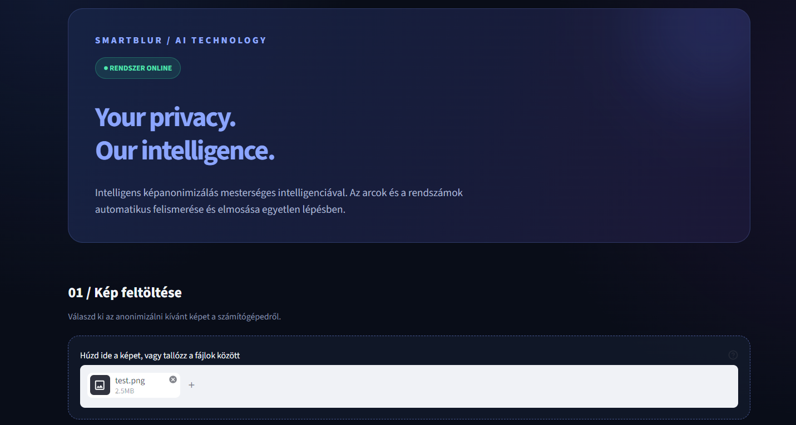
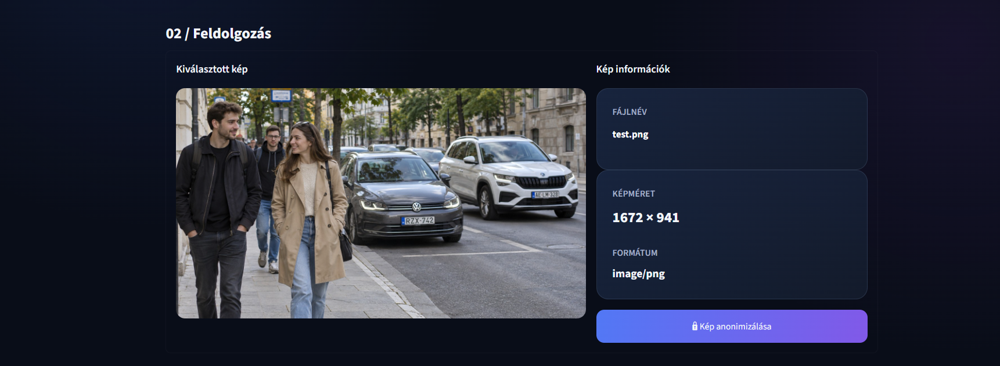
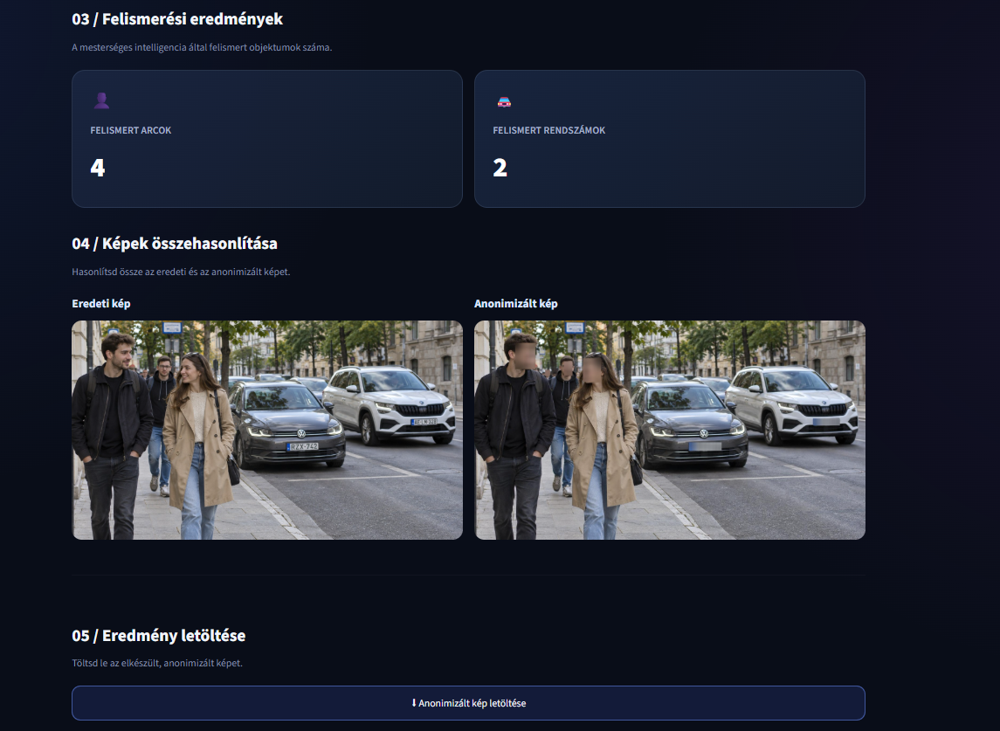

# SmartBlur

**Mesterséges intelligencián alapuló képanonimizáló alkalmazás**

A SmartBlur egy Python nyelven fejlesztett képfeldolgozó alkalmazás, amely mesterséges intelligencia segítségével automatikusan felismeri a képeken található emberi arcokat és gépjárművek rendszámtábláit, majd Gaussian Blur technikával elhomályosítja azokat.

A projekt célja a személyes adatok védelme és az érzékeny képi információk automatikus anonimizálása.

## A projekt célja és problémaköre

A digitális képek megosztása során gyakran előfordul, hogy személyes vagy érzékeny információk is láthatóvá válnak. Ilyenek például az emberi arcok és a gépjárművek rendszámtáblái.

A SmartBlur ezt a problémát automatizált képfeldolgozással kezeli. A felhasználónak elegendő feltöltenie egy képet, a rendszer pedig megkeresi az érzékeny területeket, majd elvégzi azok anonimizálását.

## Főbb funkciók

- Emberi arcok automatikus felismerése.
- Gépjárművek felismerése.
- Rendszámtáblák felismerése.
- Felismert területek automatikus elhomályosítása.
- Felismerési statisztikák megjelenítése.
- Diagnosztikai kép készítése a felismerésekről.
- Eredeti és anonimizált kép összehasonlítása.
- Feldolgozott kép letöltése.

## Felhasznált technológiák

| Technológia | Felhasználás |
|---|---|
| Python | Alkalmazás fejlesztése |
| Streamlit | Felhasználói felület |
| OpenCV | Képfeldolgozás és arcfelismerés futtatása |
| Ultralytics YOLO26n | Személyek és gépjárművek felismerése |
| YuNet | Emberi arcok felismerése |
| YOLOv8n | Rendszámtáblák felismerése |
| NumPy | Képi adatok kezelése |
| Pillow | Képek beolvasása és mentése |

## A rendszer működése

A képfeldolgozás több egymásra épülő lépésből áll:

1. A felhasználó feltölt egy képet a Streamlit felületen.
2. A YOLO26n modell felismeri a képen található személyeket és gépjárműveket.
3. A YuNet modell megkeresi az emberi arcokat a felismert személyek területén.
4. A rendszámfelismerő YOLO modell megkeresi a rendszámtáblákat a felismert gépjárművek területén.
5. A rendszer kiszűri az egymást átfedő, ismétlődő felismeréseket.
6. Az érzékeny képi területeken Gaussian Blur eljárást alkalmaz.
7. A felhasználó megtekintheti és letöltheti az anonimizált képet.

## Projektstruktúra

```text
SmartBlur/
│
├── images/
│   ├── test.jpg
│   └── README.md
│
├── models/
│   ├── license_plate.pt
│   ├── face_detection_yunet_2023mar.onnx
│   └── README.md
│
├── src/
│   ├── app.py
│   ├── pipeline.py
│   ├── detect_objects.py
│   ├── detect_license_plates.py
│   └── detect_faces.py
│
├── output/
│
├── yolo26n.pt
├── requirements.txt
├── .gitignore
├── AI_USAGE.md
└── README.md
```

## Telepítés és futtatás

### 1. A projekt letöltése

```bash
git clone https://github.com/hgergosztg-lang/SmartBlur.git
cd SmartBlur
```

### 2. Virtuális környezet létrehozása

```bash
python -m venv .venv
```

Windows PowerShell esetén:

```powershell
.\.venv\Scripts\Activate.ps1
```

### 3. Függőségek telepítése

```bash
pip install -r requirements.txt
```

### 4. Az alkalmazás indítása

```bash
python -m streamlit run src/app.py
```

Az alkalmazás alapértelmezés szerint a következő címen érhető el:

http://localhost:8501

## Modellek és adatforrások

A projekt előre betanított modelleket használ:

- **YOLO26n:** általános objektumfelismerés, személyek és gépjárművek azonosítása.
  - https://docs.ultralytics.com/models/yolo26/
- **YuNet:** arcfelismerés.
  - https://github.com/opencv/opencv_zoo
- **YOLOv8n License Plate:** rendszámtáblák felismerése.
  - https://huggingface.co/joker5914/yolov8n-license-plate

A modellek használata nem igényel saját neurális hálózat betanítását, a projekt előre betanított súlyokat alkalmaz.

## A projekt korlátai

- A felismerés pontossága függ a kép minőségétől, felbontásától és a tárgyak láthatóságától.
- A rendszámfelismerés a YOLO által előzetesen felismert gépjárművek területén történik.
- A rendszer nem garantálja minden érzékeny képi információ felismerését.
- A rendszámfelismerés nem karakterfelismerés (OCR), hanem a rendszámtábla helyének meghatározása.
- A program jelenlegi változata képek feldolgozására készült, videók anonimizálását nem támogatja.

## Fejlesztési és dokumentációs információk

A projekt egyéni fejlesztés keretében készült Python és gépi látás témakörben.

A fejlesztés során a felismerőmodellek külön tesztelése, majd egy közös képfeldolgozó rendszerbe történő integrálása valósult meg.

A mesterséges intelligencia alapú fejlesztési segítség dokumentációja az `AI_USAGE.md` fájlban található.

## Alkalmazás képernyőképei

### Főoldal



### Feltöltött kép és felismerési eredmények



### Anonimizált kép


